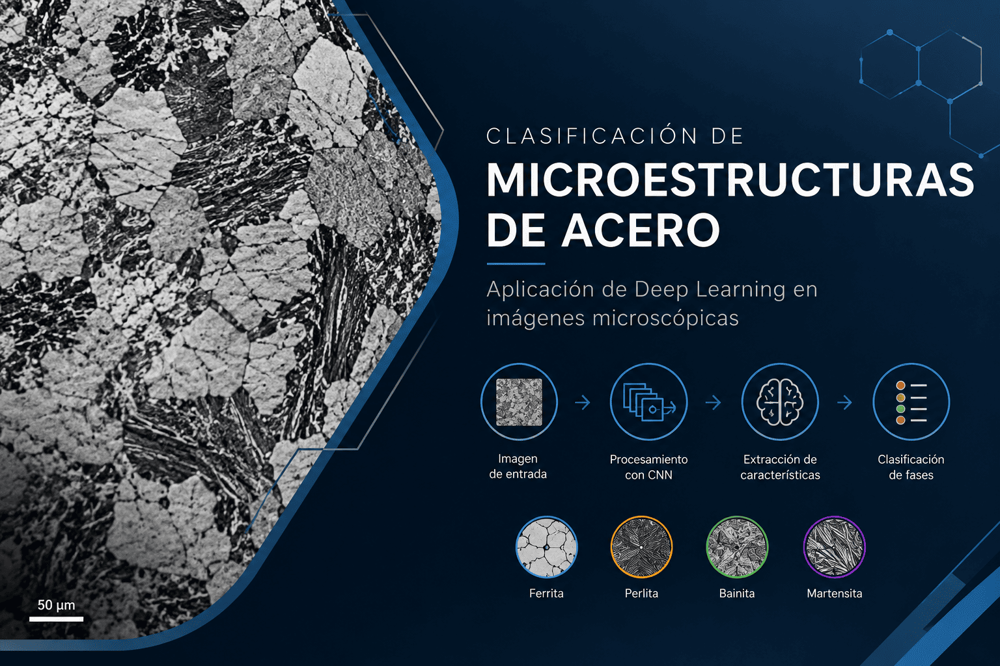

# Clasificación de microestructuras bainíticas con Deep Learning

Proyecto de **Inteligencia Artificial II**: clasificación automática de micrografías de acero bainítico en tres clases usando redes convolucionales (CNN propia, EfficientNetB0, ResNet50) y un Vision Transformer (ViT).



---

## Tabla de contenido

- [Objetivo](#objetivo)
- [Estructura del repositorio](#estructura-del-repositorio)
- [Dataset](#dataset)
- [Preprocesamiento y aumento de datos](#preprocesamiento-y-aumento-de-datos)
- [Modelos](#modelos)
- [Resultados](#resultados)
- [Interpretabilidad](#interpretabilidad)
- [Cómo ejecutar](#cómo-ejecutar)
- [Limitaciones y trabajo futuro](#limitaciones-y-trabajo-futuro)
- [Referencias](#referencias)

---

## Objetivo

Construir un clasificador confiable de micrografías de acero bainítico y comparar qué representación visual (CNN desde cero, transfer learning con CNN preentrenadas o Transformer) generaliza mejor a imágenes no vistas.

| Clase | Microestructura   |
|-------|-------------------|
| `i`   | Bainita granular  |
| `ii`  | Bainita inferior  |
| `iii` | Bainita superior  |

---

## Estructura del repositorio

```
Proyecto-IA-II-/
├── Articles/                 # Artículos de referencia y apuntes
├── Data/
│   ├── im_train/             # Imágenes de entrenamiento/validación
│   │   ├── i/  ii/  iii/
│   └── testset/              # Conjunto de prueba reservado
│       ├── i/  ii/  iii/
├── Notebooks/
│   ├── Classiffication_MicrosBainitics_EfficientNetB0_Pipeline.ipynb  # CNN propia + EfficientNetB0
│   ├── Classification_MicroBainitics_ResNet50.ipynb                   # ResNet50
│   └── Classification_MicroBainitics_Vision_Transformer-.ipynb        # ViT
├── Slides/
│   └── Clasificación de microestructuras de acero.html                # Presentación del avance
├── Portada.png
└── README.md
```

---

## Dataset

Imágenes PNG en escala de grises organizadas en una carpeta por clase.

| Conjunto   | i   | ii  | iii | Total | Resolución |
|------------|-----|-----|-----|-------|------------|
| `im_train` | 316 | 310 | 306 | 932   | 768 × 768  |
| `testset`  | 198 | 102 | 86  | 386   | 512 × 384  |

- `im_train` está equilibrado; `testset` no (la clase `i` es el 51 %, que es la referencia de "predecir siempre la clase mayoritaria").
- `im_train` se divide de forma estratificada en entrenamiento y validación (70/30 en el notebook de EfficientNet, 80/20 en ResNet50 y ViT, `random_state=42`).
- `testset` se reserva para la evaluación final.

---

## Preprocesamiento y aumento de datos

**Preprocesamiento (CNN, TensorFlow/Keras)**
- Conversión a escala de grises (1 canal).
- Recorte de las primeras 481 filas para eliminar la franja inferior (barra de escala/metadatos del microscopio).
- Redimensionado a 224 × 224.
- Para redes preentrenadas, replicación del canal gris a 3 canales (y `preprocess_input` en ResNet50).

**Preprocesamiento (ViT, PyTorch)**
- Conversión gris → RGB y `ViTImageProcessor` de Hugging Face (224 × 224, normalización).

**Aumento de datos** (solo en entrenamiento)

| Transformación        | CNN propia / EfficientNetB0 | ResNet50 | ViT |
|-----------------------|:---:|:---:|:---:|
| Flip horizontal/vertical | ✓ | ✓ | ✓ |
| Rotación (±10 %)      | ✓ | ✓ | – |
| Zoom (±10 %)          | ✓ | ✓ | – |
| Contraste             | ±20 % | ±10 % | – |

Se calculan pesos de clase balanceados (≈ 1.0 por clase, dado que la base está equilibrada).

---

## Modelos

| Modelo | Framework | Arquitectura | Entrenamiento |
|--------|-----------|--------------|---------------|
| **CNN propia** | TensorFlow/Keras | 4 bloques Conv2D (64→512) + BatchNorm + MaxPool, GAP, Dense 1024/512, Dropout 0.5 (≈ 2.6 M parámetros) | Adam 1e-3, 50 épocas, ReduceLROnPlateau |
| **EfficientNetB0** | TensorFlow/Keras | Base ImageNet congelada + GAP + Dropout 0.3 + Dense softmax | Adam 1e-3, 70 épocas, ReduceLROnPlateau |
| **ResNet50** | TensorFlow/Keras | Base ImageNet congelada + GAP + Dense 256 (L2) + Dropout 0.5 | Adam 1e-4, hasta 100 épocas, EarlyStopping (paciencia 10) + ReduceLROnPlateau |
| **ViT** | PyTorch + Transformers | `google/vit-base-patch16-224-in21k`, fine-tuning completo | AdamW 2e-5, 10 épocas, batch 8, cross-entropy ponderada |

---

## Resultados

Métricas sobre el conjunto de prueba:

| Modelo | Imágenes test | Accuracy | Precision macro | Recall macro | F1 macro | Principal confusión |
|--------|:---:|:---:|:---:|:---:|:---:|---|
| CNN propia     | 347 | 26.51 % | 8.84 %  | 33.33 % | 13.97 % | Todo se predice como `ii` |
| EfficientNetB0 | 347 | 77.23 % | 84.07 % | 72.43 % | 70.25 % | `iii` → `ii` |
| ResNet50       | 386 | 63.99 % | 79.91 % | 67.45 % | 65.06 % | `i` → `ii` |
| **ViT**        | 386 | **97.67 %** | **98.12 %** | **97.00 %** | **97.51 %** | 9 errores en total |

**Resultados por clase del ViT (mejor modelo)**

| Clase | Precision | Recall | F1 |
|-------|:---:|:---:|:---:|
| i   | 0.9659 | 1.0000 | 0.9826 |
| ii  | 0.9895 | 0.9216 | 0.9543 |
| iii | 0.9884 | 0.9884 | 0.9884 |

**Conclusiones principales**
- El preentrenamiento ayuda más que diseñar una CNN desde cero: la CNN propia llega a ~75 % en validación pero colapsa en test.
- Las CNN validan entre 75 % y 93 %, pero en test caen y concentran sus errores en la clase `ii`. Las imágenes de test tienen otra resolución (512 × 384 vs 768 × 768), lo que sugiere un cambio de distribución entre entrenamiento y prueba.
- El ViT es el modelo que mejor generaliza (97.67 % en test).

> ⚠️ CNN propia y EfficientNetB0 se evaluaron sobre el 90 % del `testset` (347 imágenes); ResNet50 y ViT sobre el `testset` completo (386). Las cifras no son estrictamente comparables.

---

## Interpretabilidad

Cada notebook incluye visualizaciones de lo que aprende la red:

- **CNN / EfficientNetB0 / ResNet50:** filtros de la primera convolución y mapas de activación de capas intermedias (de bordes y contrastes a estructuras de mayor escala), comparados entre clases.
- **ViT:** filtros de la proyección de parches 16 × 16, canales de los estados ocultos por bloque, atención del token `CLS` en los bloques 1, 4, 8 y 12, y *attention rollout* para una muestra de cada clase.

---

## Cómo ejecutar

Los notebooks están pensados para **Google Colab** con GPU.

1. Sube la carpeta `Data/` a tu Google Drive (con las subcarpetas `im_train/` y `testset/`).
2. Abre el notebook en Colab y activa la GPU (*Entorno de ejecución → Cambiar tipo de entorno*).
3. Ajusta la variable de ruta al inicio del notebook para que apunte a tu carpeta en Drive:
   - EfficientNetB0: `ruta`
   - ResNet50: `RUTA_BASE`
   - ViT: `ruta`
4. Ejecuta las celdas en orden.

**Dependencias principales**

```
tensorflow
torch
transformers
scikit-learn
pandas
numpy
matplotlib
seaborn
pillow
tqdm
```

Salidas generadas:
- ResNet50: `resnet50_bainita.keras`, `predicciones_resnet50_test.csv`, `metricas_resnet50_test.csv`.
- ViT: carpeta `modelo_vit_entrenado/` (pesos, procesador e `historial.csv`) en Drive.

---

## Limitaciones y trabajo futuro

- Unificar el protocolo de evaluación: mismo split, mismo `testset` completo y mismas métricas para todos los modelos.
- Tratar igual las imágenes de entrenamiento y de test en el preprocesamiento (diferente resolución y franja inferior).
- La separación train/validación es por ruta de archivo; varios archivos son recortes de una misma micrografía (sufijos `_1_1`, `_1_2`, …), lo que puede inflar la validación. Conviene agrupar por micrografía original.
- Explorar hiperparámetros usando solo validación, sin ajustar con el test.
- Fine-tuning de las capas superiores de EfficientNetB0 y ResNet50.

---

## Referencias

Artículos de apoyo en [`Articles/`](./Articles):

- *Advanced Steel Microstructural Classification by Deep Learning Methods*
- *Computer vision of ferrite, pearlite, austenite, bainite, and martensite*
- *Metallurgical microstructure classification using CNN: A comprehensive review*
- *UHCS – ViT CNN*
